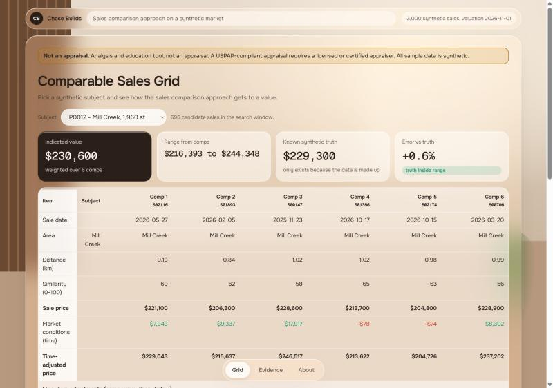

# comparable-sales-grid

[](https://github.com/chasebuilds/comparable-sales-grid/actions/workflows/ci.yml)

**Turn a file of home sales into a defensible comparable sales grid in seconds.** Give it a subject property and a sales CSV. It finds the comps, measures the adjustments from your own data, flags the ones that break the 15% net / 25% gross guidelines, and writes an Excel workbook and a printable page with the weighted value and range.

**Try it:** https://chasebuilds.github.io/comparable-sales-grid/ (pick a synthetic subject, see the whole grid)

> **Not an appraisal.** Analysis and education tool. A USPAP-compliant appraisal requires a licensed or certified appraiser. All sample data is synthetic.



On 200 synthetic subjects the reconciled value had a median error of 2.05% against the known truth, with 93.0% within 5% and 100.0% within 10% (details in [Benchmark](#benchmark)).

## What it does

1. **Comp search.** Sales before the valuation date inside a radius and a recency window (12 months, widened if fewer than 8 candidates). Each gets a 0 to 100 similarity score from distance, recency, living area, beds, baths, age, lot, condition and quality.
2. **Market conditions adjustment.** A monthly index from a regression with month fixed effects. The valuation month usually has no sales, so it is extrapolated from the last 6 months.
3. **Line-item adjustments, measured from the data.** Two estimates per feature, shown side by side:
   - a regression of ln(price) on all features plus area and month effects;
   - paired-sales extraction: same-area sale pairs that match on every other feature and differ in one, with prices moved to one date by the index.

   Location comes from the area effects. `--method regression` (default), `paired` or `blend` picks which rate drives the grid.
4. **Net and gross percentages**, flagged at 15% net and 25% gross of the time-adjusted price.
5. **Selection.** From the 20 most similar candidates, comps inside the guidelines are ranked by gross adjustment and the best 3 to 6 are kept, each with a plain-text reason. If fewer than 3 pass, the best remaining are added and flagged.
6. **Reconciliation.** Weights are the inverse of each comp's gross adjustment percent (floor 3%). Output is the weighted indicated value and the low/high range of the adjusted comps.

## Analyst controls and checks

- **Pin or drop comps.** `--include S01,S02,S03` fixes the comps (3 to 6, any distance or age) and skips automatic selection. `--exclude S09` removes a sale you know was not at arm length. Bad ids, wrong counts and pinned sales dated after the valuation date are rejected with a plain message.
- **Leave-one-out.** The indicated value is recomputed without each comp in turn, so you can see how much one sale drives the answer.
- **Bracketing.** For each feature, whether the subject sits inside the comps' range. Subjects outside it lean on extrapolated adjustments.
- **Batch summary.** `csg batch` writes one CSV row per subject (value, range, comps used, flagged comps, bracketing, leave-one-out spread, and error if truth is present). On the sample 200: 41% of subjects are bracketed on every feature, and the median leave-one-out spread is 2.76% of the value.

## Use it

```
pip install -e ".[dev]"
csg generate                       # writes data/sales.csv and data/subjects.csv (seeded, synthetic)
csg run --sales data/sales.csv --subjects data/subjects.csv --subject-id P0012 --out out
csg run ... --include S00012,S00450,S01200   # pin your own comps
csg batch --sales data/sales.csv --subjects data/subjects.csv   # summary CSV for all subjects
csg benchmark --sales data/sales.csv --subjects data/subjects.csv
csg demo-data --sales data/sales.csv --subjects data/subjects.csv   # rebuilds web/data.json
```

`csg run` writes `out/P0012.xlsx` and `out/P0012.html`. The workbook has five sheets: Grid (net, gross, adjusted price and the indicated value are live Excel formulas), Comps (every candidate with scores), Adjustment evidence (regression and paired rates, pair counts, area effects), Market index and Notes. Samples are in [`samples/`](samples).

Your own sales file needs these columns: `sale_id, sale_date (YYYY-MM-DD), neighborhood, x_km, y_km, sale_price, gla, beds, baths, age, lot, condition, quality`. A subjects file needs the same attributes plus `subject_id`.

## Benchmark

200 synthetic subjects (not in the sales file) scored against their known true value, against a market of 3,000 synthetic sales. Full table in [`benchmark/BENCHMARK.md`](benchmark/BENCHMARK.md), raw numbers in `benchmark/results.json`.

| Rate method | Median abs % error | Within 5% | Within 10% | Truth inside comp range |
|---|---|---|---|---|
| regression (default) | 2.05% | 93.0% | 100.0% | 91.0% |
| paired | 2.54% | 83.0% | 99.5% | 77.5% |
| blend | 2.09% | 90.5% | 100.0% | 82.5% |

Context from the same run: time-adjusting the chosen comps with no line adjustments gives 4.76% median error (50.5% within 5%). A direct regression prediction with no comps gives 1.48%, which beats the grid. That is expected here, because the synthetic prices come from a log-linear model the regression can recover. The grid's job is to show its work, not to beat the regression on made-up data. Paired estimates are noisier because only 23 to 70 pairs per feature survive the matching rules.

## Tests and checks

`pytest` (21 tests: seeded data, recovery of true rates, grid rules, pinned and excluded comps, bracketing, leave-one-out, batch, workbook formulas, HTML, CLI, benchmark), `ruff`, and `mypy --strict` all run in CI on Python 3.11 and 3.13.

## Limitations

See [LIMITATIONS.md](LIMITATIONS.md). Short version: synthetic data, a model the generator happens to match, no inspection, no market-area judgment, no USPAP.

## Data

Every sale and subject comes from `src/comparable_sales_grid/market.py` with a fixed seed. No real people, owners or addresses. Neighborhood names and prices are invented. The data and code are MIT licensed.

## License

MIT, Chase Builds. See [LICENSE](LICENSE).

## More from Chase Builds

- **[seller-net-sheet-cma](https://github.com/chasebuilds/seller-net-sheet-cma)**: Seller net sheet, buyer cash to close and a CMA presentation in one page. 20,000 of 20,000 prorations correct to the cent. ([live demo](https://chasebuilds.github.io/seller-net-sheet-cma/))
- **[listing-kit](https://github.com/chasebuilds/listing-kit)**: One file becomes a listing website with gallery, map and flyer, plus a fair-housing wording checker. ([live demo](https://chasebuilds.github.io/listing-kit/))
- **[showing-route-planner](https://github.com/chasebuilds/showing-route-planner)**: Orders a day of showings around every listing window with the least driving. Works offline on a phone. ([live demo](https://chasebuilds.github.io/showing-route-planner/))

[All projects, sorted by industry](https://github.com/chasebuilds) · [chasebuilds.github.io](https://chasebuilds.github.io)
